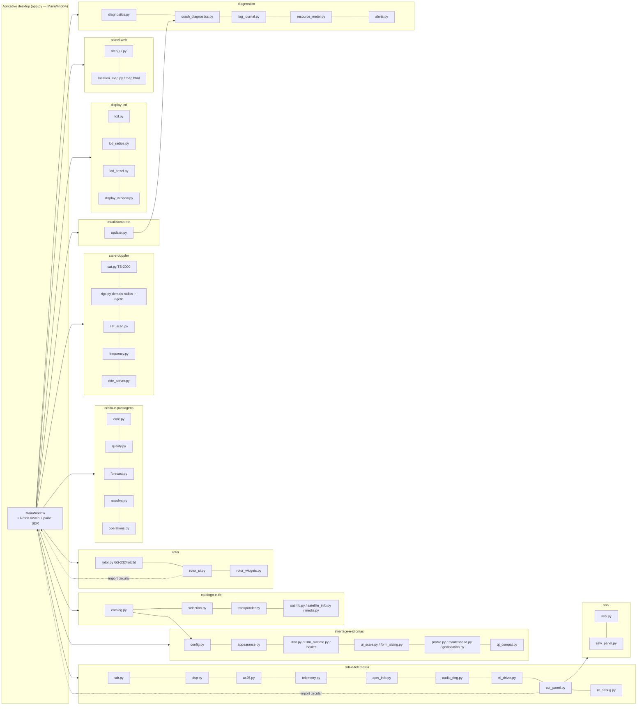

# C4 Componentes — Aplicativo desktop

> Reversa (Arquiteto), 27/11/2026. Grafo de imports extraído por AST (🟢). Os componentes seguem as 12
> funcionalidades das specs.

## Observações
- 🟢 `app.py` (5.225 linhas) concentra a orquestração; `rotor_ui.py` e `sdr_panel.py` são mixins/painéis que
  importam `app` de volta (acoplamento circular resolvido em tempo de execução).
- 🟢 Os módulos de domínio puro (`core`, `cat`, `rigs`, `rotor`, `dsp`, `ax25`, `sstv`, `web_ui`, `frequency`)
  não importam nada do pacote: são testáveis isoladamente, e é aí que está a maior parte dos 394 testes.
- 🟢 `diagnostics.py` importa quase tudo: é o autoteste de inicialização e o relatório de suporte.
