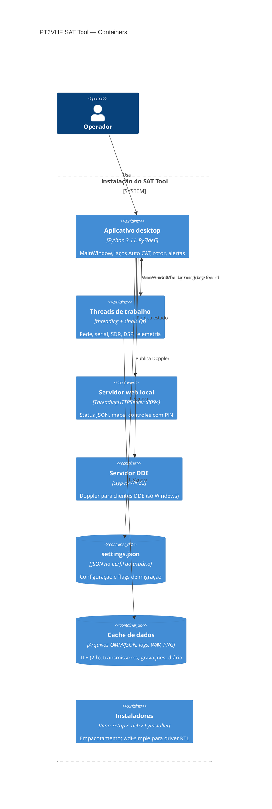

# C4 Containers — PT2VHF SAT Tool

> Reversa (Arquiteto), 27/11/2026. O sistema é um único processo desktop; os "containers" abaixo são as
> unidades executáveis e de dados dentro da instalação. 🟢 CONFIRMADO.

