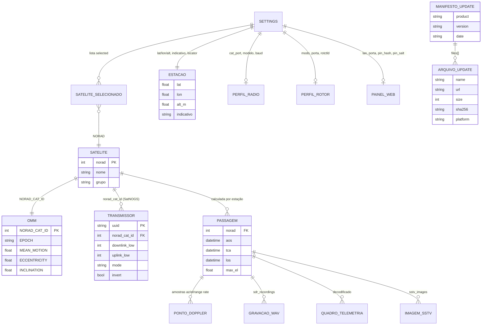

# ERD — Dados persistidos e trocados

> Reversa (Arquiteto), 27/11/2026. Não há banco de dados: a persistência é em arquivos JSON/CSV/WAV/PNG no
> perfil do usuário. O diagrama mostra as entidades lógicas e como se ligam. Atributos completos em
> [data-dictionary.md](data-dictionary.md).

🟡 `PASSAGEM`, `PONTO_DOPPLER` e quadros de telemetria vivem em memória e em CSV/log; só gravações, imagens
e o diário são persistidos.
