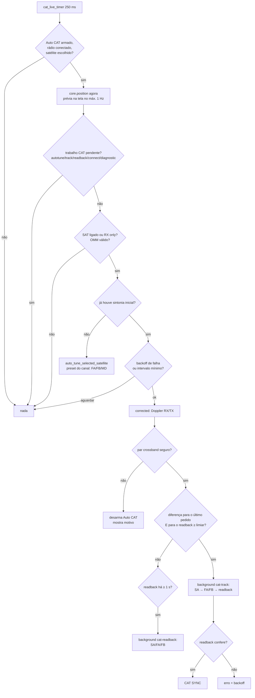

# Fluxo — Auto CAT Doppler (TS-2000)

> 🟢 `app.py: cat_live_tick` (250 ms) → `track_cat_frequencies` → `cat.TS2000.set_frequencies`

## Regras
- Escrita só com SAT ligado e orientação MAIN/SUB igual à esperada (`set_frequencies`). 🟢
- O programa nunca envia PTT; FC (receptor SUB) nunca é tratado como uplink. 🟢
- Leituras opcionais (S-meter, potência, medidores) em trabalhador separado, no máx. a cada 5–6 s. 🟢
