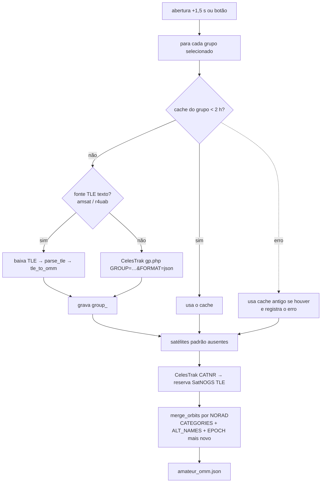

# Fluxo — Atualização do catálogo orbital

## Transmissores (botão Atualizar frequências)
1. `GET https://db.satnogs.org/api/transmitters/?format=json` (todas as páginas, só no próprio domínio). 🟢
2. Agrupa por `norad_cat_id`, grava `tx_<norad>.json` de quem tem transmissor; zera quem deixou de ter. 🟢
