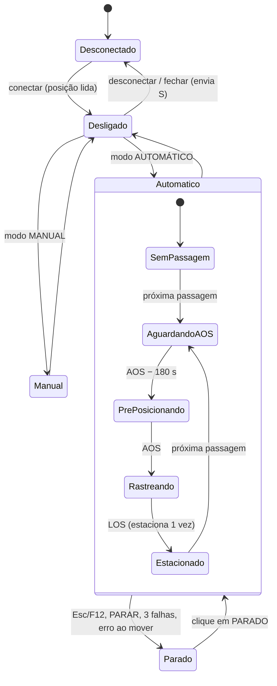
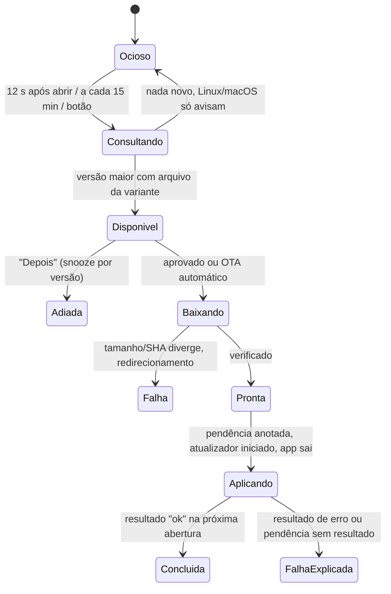

# Máquinas de estado — PT2VHF SAT Tool

> Reversa (Detetive), 27/11/2026.

## 1. Auto CAT (TS-2000) 🟢 `app.py`

```mermaid
stateDiagram-v2
  [*] --> Desconectado
  Desconectado --> Conectando: Conectar / abertura com porta salva
  Conectando --> Conectado: ID019; confirmado
  Conectando --> Desconectado: falha (porta ausente / em uso / sem resposta)
  Conectado --> SAT_OFF: SA P1=0
  SAT_OFF --> Conectado: operador liga SAT
  Conectado --> Armado: Auto CAT ligado + satélite + canal crossband
  Armado --> SintoniaInicial: primeira vez (preset FA/FB/MD)
  SintoniaInicial --> Rastreando: readback confere
  SintoniaInicial --> Backoff: falha
  Rastreando --> Rastreando: Doppler ≥ limiar → escreve e confere
  Rastreando --> Backoff: readback diverge / timeout
  Backoff --> Rastreando: tempo de espera passou
  Rastreando --> Bloqueado: par inseguro (mesma banda / sem uplink)
  Bloqueado --> Armado: operador escolhe outro canal
  Armado --> Conectado: Auto CAT desligado
  Conectado --> Desconectado: Desconectar / fechar
```

## 2. Rotor 🟢 `rotor_ui.py`

Modos escolhidos pelo operador: **DESLIGADO** (padrão), **MANUAL**, **AUTOMÁTICO**.
Chips exibidos no modo automático: AGUARDANDO AOS → PRÉ-POSICIONANDO → RASTREANDO → ESTACIONADO.

## 3. Atualização OTA 🟢 `app.py` + `updater.py` + `apply-update.ps1`

## 4. Receptor SDR 🟢 `sdr.py`

`Parado → Rodando (start) → Gravando (início da passagem, se ligado) → Rodando (LOS) → Parado (stop / erro)`.
Erro na thread vira `status.error` com ajuda de driver (`open_error_help`).

## 5. Aviso de passagem 🟢 `alerts.py`

`Agendado (leads 1800/30 s) → Disparado por lead (uma vez cada) → Removido (após o LOS)`.
